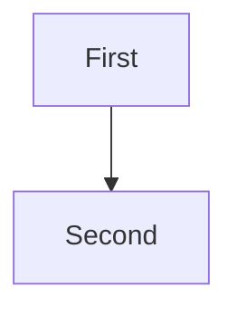

# Note Mermaid

Notes render exact, case-sensitive `mermaid` fences as images. Source stays visible while work is pending and remains intact with a diagnostic on failure. Narrow diagrams are centred in the note.

## Sub-features

- `mermaid-live` replaces source with a current diagram, including after source, width, and appearance changes.
- `mermaid-layers` keeps live bitmap layers aligned through prose edits, scrolling, zoom, resizing, parking, and selection in a closed board.
- `mermaid-consumers` shares completed logical dimensions with cards, fit, delegated measurement, full render, and native PNG export. Markdown copy stays byte-exact.
- `mermaid-cold` renders the first fence after a fresh app launch, including recovery from one preparation failure.
- `mermaid-bounds` preserves source on malformed or over-limit input and terminates timed-out renderer processes before fallback.

## How to get to it (user POV)

Create or edit a note containing this Markdown. Leave editing to see the diagram. The API can seed the fixture, but does not qualify native editing.

````text
# Centred Mermaid

Before the diagram.



After the diagram.
````

## Driving it with dev.sh

Follow Launch and Doctor in the claimed guest. Keep a fresh exact-PID/window capture before the action and after completion. Use a 660-point-wide note so the narrow TD diagram has visible space on both sides.

1. Create the fixture through `object.create` with `type: note`, `props.markdown`, and frame `{x:0,y:0,w:660,h:480}`. Retain its ID as `NOTE` and its original Markdown. Navigate to its heading with Command-P, then use Command-0. Require First, Second, their arrow, trailing prose, and equal left/right diagram margins within capture rounding. A `rendered` object record alone cannot distinguish a diagram from source fallback.
2. Edit prose above the fence natively and commit with Escape. Require the same diagram, centred below the new prose, without a grey or missing image. Change TD to LR and back; resize narrow/wide, scroll internally, zoom below 0.3 and restore, then park and return. Capture each affected state. Compare `props.markdown` with the committed source.
3. Run `scripts/dev.sh cli view.render --json "{\"target\":\"$NOTE\",\"full\":true,\"scale\":2,\"timeoutMs\":60000,\"out\":\"$G/proof/mermaid-full.png\"}"`. Inspect the PNG for the diagram and trailing prose. Compare fit and full-render dimensions. Exercise native Copy as Image and Save PNG separately when qualifying those menu paths. Copy Markdown and compare bytes.
4. Repeat on the guest-local scratch remote board. The viewing Mac renders Mermaid. Headless easld measures code approximately; `text.measure` with Mermaid diagrams uses its existing delegated viewer route, not a standalone local-Mac method. An older viewer can preserve the same Markdown while showing source.

### Run the native regressions

Run only inside the claim. These supplement displayed-window proof, not replace it. Keep compiler work outside timed intervals.

```sh
swift build --build-system native -j 2 --product Easl
BIN=$(swift build --build-system native --show-bin-path)
python3 Tests/NoteMermaid/run.py --bin-path "$BIN"
swift build --build-system native -c release -j 2 --product Easl -Xswiftc -enable-testing
OPT=$(swift build --build-system native -c release --show-bin-path)
python3 Tests/NoteMermaidChurn/run.py --bin-path "$OPT" \
  --scratch "$G/churn" --artifacts "$G/proof/churn"
```

Both runners are steps in `.github/workflows/ci.yml`'s `test` job. The first checks actual WebKit images, fallback, dimensions, source swaps, and exports. Churn requires optimized testable objects and checks 25 prose edits, geometry, selected-image pixels, parking/deletion, and recovery after heavy timeouts. `--profile` disables the 50 ms assertion, so a profile run is not a passing churn qualification.

For staged exact-window checks, add `--stage-seconds 15 --timeout 1200`. Read each new `stage.json`, verify its recorded PID/window, and capture that window during the pause. Test zooms 0.65 and 1.35, internal scrolling, edits above, resize, reattachment, and read-only selection. Keep cached AppKit pixels and live WindowServer pixels: correct sibling order alone can still produce a grey live compositor. The independent selected-text edge witness must match at offset 0,0. Known 2-point X/Y mutations must fail it; do not reuse the earlier upside-down reference.

### Rerun the retained lane probes

The private probe sources are prerequisites, not files shipped with easl. On the lane machine, inspect and copy only the named scripts and synthetic fixtures through home into the current `G`. Replace archived scratch paths, lane/session names, binary paths, and output labels before running. Never execute an archived controller unchanged against its deleted scratch or reuse an archived binary as current-head proof.

The current first runner still checks a 2.5-second **total** cold-start bound at `Tests/NoteMermaid/NoteMermaid.swift:150`. It can fail intermittently after the separate preparation budget introduced in #199. Retain that failure and its CI run link; do not rerun to obtain green or change the test in a skill refresh. This failure alone does not establish that the two-second ready-to-render deadline was exceeded.

Sources:

- `/home/tim/lane-evidence/easl/easl-note-mermaid-1/acceptance.md` records the ordinary, hostile, network, process, and remote matrices.
- `/home/tim/lane-evidence/easl/easl-note-mermaid-2-1/acceptance.md` supersedes its left-alignment and combined-startup-deadline observations. Scripts beside these files retain the rerun inputs.

Use these probe groups:

Run group 1 before group 5. Its controller builds `$G/cold-consumer`, which the fault controller requires in addition to the GUI helper.

1. **Cold first fence:** copy `gui-local-proof.py` and `cold-app-proof.py` from the follow-up lane. Set their `G`, `R`, `BINARY`, and unique session to the current run. The controller compiles the window/input/OCR helpers once, launches ten fresh isolated apps, creates Cold→Ready, calls `view.render`, inspects each export for diagram labels rather than fence text, and captures trials 0 and 9. Run `python3 "$G/cold-app-proof.py" candidate "$G/frozen.app/Contents/MacOS/Easl" "$G"`. Retain per-launch PID/window, signed executable hash, source, export, and outcome. Its elapsed endpoint is render completion, not first presentation.
2. **Hostile set:** use the original lane's `hostile.json` and `stress.json`, with the follow-up's `PreparedMermaidProof.swift` and `link-process-proof.py`. The prepared backend preserves readiness accounting; the older `NativeMermaidProof.swift` adapter combines preparation and render time and is not the current deadline probe. Link against the current optimized native objects: `python3 "$G/link-process-proof.py" --repo "$R" --source "$G/PreparedMermaidProof.swift" --out "$G/process-probe"`. Supply ordinary fixtures plus 590 sequence regions, 1100 radar curves, 20-deep/400-cross-edge subgraphs, huge treemap, malformed syntax, and 3300-curve radar. Render or diagnostic-plus-intact-source are valid hostile outcomes. Old hostile fixtures can now render successfully; do not pin their former fallback outcomes.
3. **Fifty timeouts and leak audit:** copy `preparation-series.py`, then run `python3 "$G/preparation-series.py" --scratch "$G" --repo "$R" --binary "$G/process-probe" --label natural-50 --count 50`. It consumes `stress.json`, reuses one note, and writes `proof/natural-50`. Require 50 natural warm-render fallbacks, distinct recorded WebContent PIDs all gone, and zero retained renderer views after every trial. Retain preparation, active, total, heartbeat gaps, and parent footprint before/after clearing the bounded failure cache. Compare early/late cold preparation and benign termination controls. This proves measured ownership, not an exhaustive heap audit. Forced infinite loops are a separate fault probe, never natural-timeout evidence.
4. **Hostile layer geometry:** extract the synthetic Mermaid sources into individual UTF-8 files. Add repeated `--fixture NAME=PATH` to the churn runner for sequence590, radar1100, nested-cross, and treemap. Keep input hashes. Its largest-raster selection and independent edge checks cover actual image layers rather than only attachment rectangles.
5. **Controlled faults:** copy `preparation-app-proof.py`, `rule-delay.m`, and `rule-failure.m` from the follow-up lane, plus its GUI helper. Build each hook once in `G` with `clang -dynamiclib -framework Foundation -framework WebKit SOURCE -o OUTPUT`, then ad-hoc sign the dylib. Use `rule-delay.dylib` and `rule-failure.dylib`. Run `python3 "$G/preparation-app-proof.py" candidate delay "$G" frozen.app/Contents/MacOS/Easl`, then the same command with `failure`. Require the logged 2.2-second policy-delay or one-shot-failure marker, successful first image, and the same image on a second unchanged-key request. Set DYLD insertion only for the owned app; the hooks remove it before descendants launch. Keep these fault runs separate from ordinary latency and natural process audits.

Stop each owned app/probe and end its Cua session in `finally`. Preserve failed attempts. Run Doctor again after a surprise, reset a wedged UI, and export evidence before removing scratch.

## Gotchas

- Two nonpersistent WKWebView slots load only a fixed renderer page, kit CSS, and vendored Mermaid script. Source is a JavaScript argument. Network, file/image/link loading, and privileged HTML bridges are unavailable.
- Preparation has a ten-second bound. The two-second active-render clock starts after policy, process launch, script load, and readiness. Preparation timeouts and infrastructure failures retry once before caching fallback. Warm timeouts and content failures do not retry. Queue wait is separate; two seconds is not a total cold-launch SLA.
- Limits are 20 occurrences per note, 51,200 UTF-8 source bytes per fence, 8192 physical pixels per side, 4,194,304 pixels per image, and at most 2× raster density. The cache is bounded to 32 MiB/512 entries; admission is bounded to 128 queued jobs/256 consumers. No easl chart-type work budgets apply. The renderer also sets Mermaid's own `maxEdges: 500`; engine-limit failures retain source.
- Cache keys include source, effective whole-point width, and appearance. A final fallback persists until key change, eviction, or relaunch. Prose-only edits do not retry it. Stale source/width/appearance/lifetime callbacks must not publish.
- Live notes use retained CGImage-backed layers positioned from TextKit attachment rectangles. Exports retain ordinary image attachments. Open-board rendered text is not selectable; closed-board selection is a separate supported path.
- DOM painting stays in the renderer's own killable web-content process. The guarded WebKit feature can omit GPU-related sandbox restrictions on some builds; do not claim identical hardware-driver isolation. Missing feature or termination support keeps source. macOS 14/15 runtime behavior needs its own proof.
- Source entry points are `Sources/CanvasCore/NoteMermaid.swift`, `Sources/CanvasCore/NoteRenderer.swift`, `Sources/CanvasApp/Notes/NoteMermaidWeb.swift`, and `Sources/CanvasApp/Notes/NoteTile.swift`.
